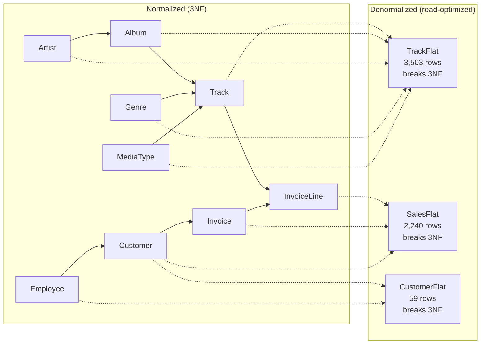
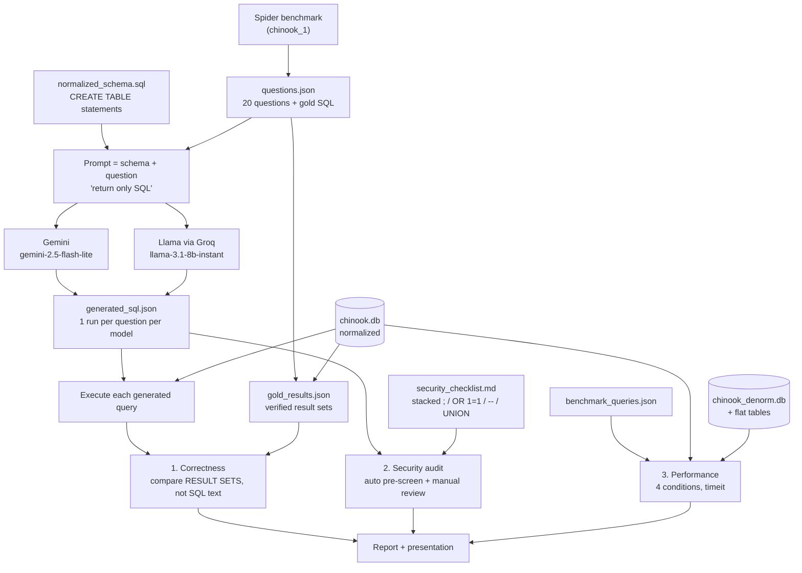
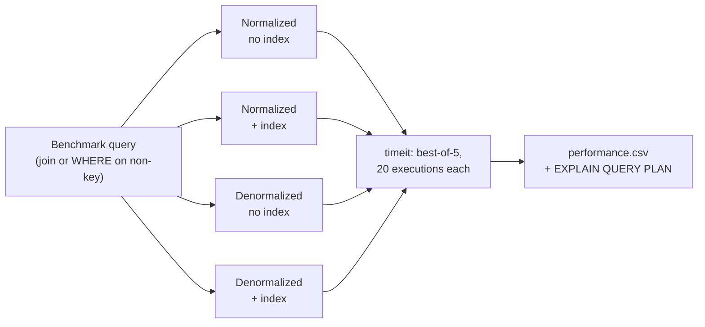

# Diagrams

GitHub renders these Mermaid blocks automatically. For slides later, screenshot them from the
rendered page, or paste a block into mermaid.live to export a PNG.

## 1. ER diagram — normalized Chinook (3NF)

Row counts are from our local build. Crow's-foot notation: `||--o{` is one-to-many.

```mermaid
erDiagram
    ARTIST     ||--o{ ALBUM        : "records"
    ALBUM      ||--o{ TRACK        : "contains"
    GENRE      ||--o{ TRACK        : "classifies"
    MEDIATYPE  ||--o{ TRACK        : "encodes"
    TRACK      ||--o{ INVOICELINE  : "is sold as"
    TRACK      ||--o{ PLAYLISTTRACK : "appears in"
    PLAYLIST   ||--o{ PLAYLISTTRACK : "groups"
    INVOICE    ||--o{ INVOICELINE  : "itemizes"
    CUSTOMER   ||--o{ INVOICE      : "is billed"
    EMPLOYEE   ||--o{ CUSTOMER     : "supports"
    EMPLOYEE   ||--o{ EMPLOYEE     : "reports to"

    ARTIST {
        int ArtistId PK "275 rows"
        nvarchar Name
    }
    ALBUM {
        int AlbumId PK "347 rows"
        nvarchar Title
        int ArtistId FK
    }
    TRACK {
        int TrackId PK "3503 rows"
        nvarchar Name
        int AlbumId FK "nullable"
        int MediaTypeId FK
        int GenreId FK "nullable"
        nvarchar Composer
        int Milliseconds
        numeric UnitPrice
    }
    GENRE {
        int GenreId PK "25 rows"
        nvarchar Name
    }
    MEDIATYPE {
        int MediaTypeId PK "5 rows"
        nvarchar Name
    }
    PLAYLIST {
        int PlaylistId PK "18 rows"
        nvarchar Name
    }
    PLAYLISTTRACK {
        int PlaylistId PK_FK "8715 rows"
        int TrackId PK_FK
    }
    CUSTOMER {
        int CustomerId PK "59 rows"
        nvarchar FirstName
        nvarchar LastName
        nvarchar Address
        nvarchar Country
        nvarchar Email
        int SupportRepId FK "nullable"
    }
    EMPLOYEE {
        int EmployeeId PK "8 rows"
        nvarchar FirstName
        nvarchar LastName
        nvarchar Title
        int ReportsTo FK "nullable"
    }
    INVOICE {
        int InvoiceId PK "412 rows"
        int CustomerId FK
        datetime InvoiceDate
        nvarchar BillingCity
        nvarchar BillingCountry
        numeric Total
    }
    INVOICELINE {
        int InvoiceLineId PK "2240 rows"
        int InvoiceId FK
        int TrackId FK
        numeric UnitPrice
        int Quantity
    }
```

## 2. Denormalized variant — what collapses into what

Each flat table absorbs the tables on its left, removing joins at the cost of 3NF violations
(details in [deliverable1_writeup.md](deliverable1_writeup.md)).



| Flat table | Joins removed | Benchmark questions served |
|---|---|---|
| `TrackFlat` | 4 | Q09, Q10, Q13, Q14, Q15, Q20 |
| `SalesFlat` | 3 | Q02, Q07, timing queries |
| `CustomerFlat` | 1 | Q11, Q12, Q16 |

## 3. Evaluation pipeline — how the benchmark runs

This is the architecture of the experiment: one prompt, two models, three graded dimensions.



## 4. The four performance conditions



Note: Chinook ships 11 of its own `IFK_*` foreign-key indexes, so the "no index" conditions must
drop those first or the baseline is already indexed.
